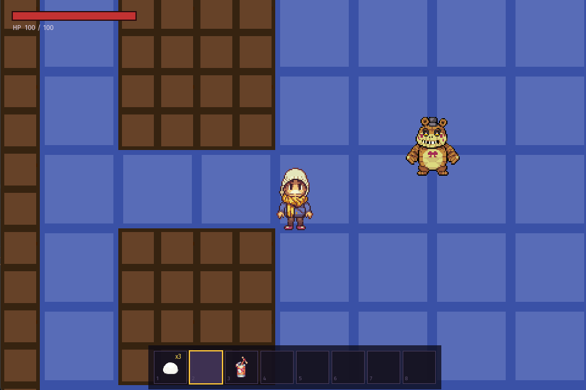
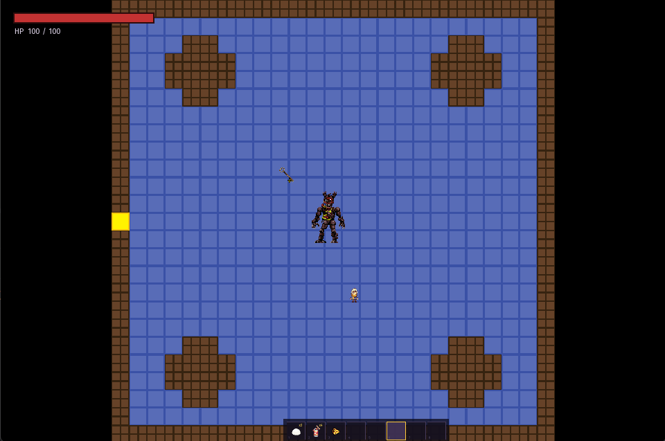
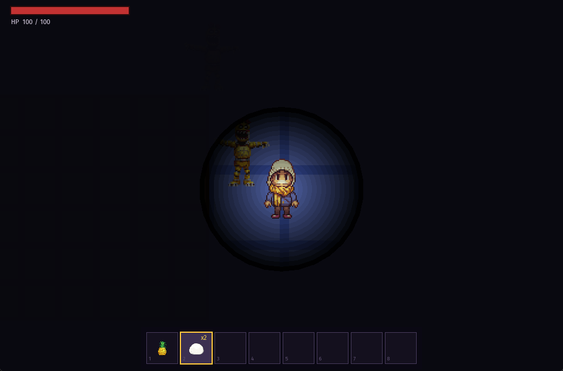

# Escape the Pizzeria

A 2D survival-explorer game inspired by *Five Nights at Freddy's*, written in **C++23** with **SFML**.
You play as Billy, a curious kid exploring the abandoned Freddy Fazbear's Pizzeria, and the animatronics
are awake. Your only defences are old slices of pizza and a good pair of legs.

> *"He who fights and runs away, gets to live another day."*

      

## Features

- Top-down exploration of a multi-room pizzeria
- **Four animatronics** (Freddy, Foxy, Chica, Nightmare), each with its own behaviour
- **Combat by pizza**: craft pizza and throw it at animatronics to kill them or slow them down
- **Inventory system** with a backpack, item slots, and a UI
- **Items**: dough, toppings, pizza, soda, keys
- **Status effects**, such as food poisoning from eating bad food
- Menu, pause, death, respawn, and win flows

## Controls

| Key | Action |
|---|---|
| `W` `A` `S` `D` | Move |
| `Space` | Throw pizza |
| `E` | Eat/Use item |
| `C` | Craft pizza |
| `F11` | Fullscreen | 
| `Esc` | Pause/Resume |

## Getting started

### Option 1: Download a build
Grab the latest build from the [Releases page](https://github.com/bencheamatei/Escape-the-Pizzeria/releases), unzip it, and run `oop`.

### Option 2: Build from source

**Requirements:** a C++23 compiler (GCC, Clang, or MSVC), CMake 3.26+, and Git.
SFML 2.6.2 and nlohmann/json are downloaded automatically by CMake, so the first configure takes a few minutes.
On Linux you also need the usual SFML system dependencies (X11, OpenGL, etc.).

```bash
git clone https://github.com/bencheamatei/Escape-the-Pizzeria.git
cd Escape-the-Pizzeria

cmake -S . -B build -DCMAKE_BUILD_TYPE=Release
cmake --build build --parallel

./build/oop
```

On Windows with GCC (Git Bash), add `-G Ninja` to the configure step.

Extra build options (sanitizers, Valgrind, install)

```bash
# AddressSanitizer (Linux/macOS)
cmake -S . -B build -DCMAKE_BUILD_TYPE=Debug -DUSE_ASAN=ON

# Install to a local folder
cmake --install build --config Release --prefix install_dir
./install_dir/bin/oop

# Valgrind (Linux, or WSL on Windows)
./scripts/run_valgrind.sh
```

The helper script `scripts/cmake.sh` wraps the configure, build, and install steps.

## Project structure

```
include/, src/
├── animatronic/    Animatronic base class, Freddy/Foxy/Chica/Nightmare, animatronic_ai
├── items/          Item hierarchy (dough, topping, pizza, soda, key, backpack) + item_factory
├── scenes/         Scene manager, menu / game / pause scenes, scene builder
├── game_states/    Playing, death, respawn, and win states
├── renders/        Rendering for the player and animatronics
└── ...             player, inventory, room, status effects, exceptions
assets/, images/, fonts/   Game resources
```

## License

Licensed under [AGPL-3.0](LICENSE). Based on the [oop-template](https://github.com/mcmarius/oop-template), which is under the [Unlicense](LICENSE.template).
